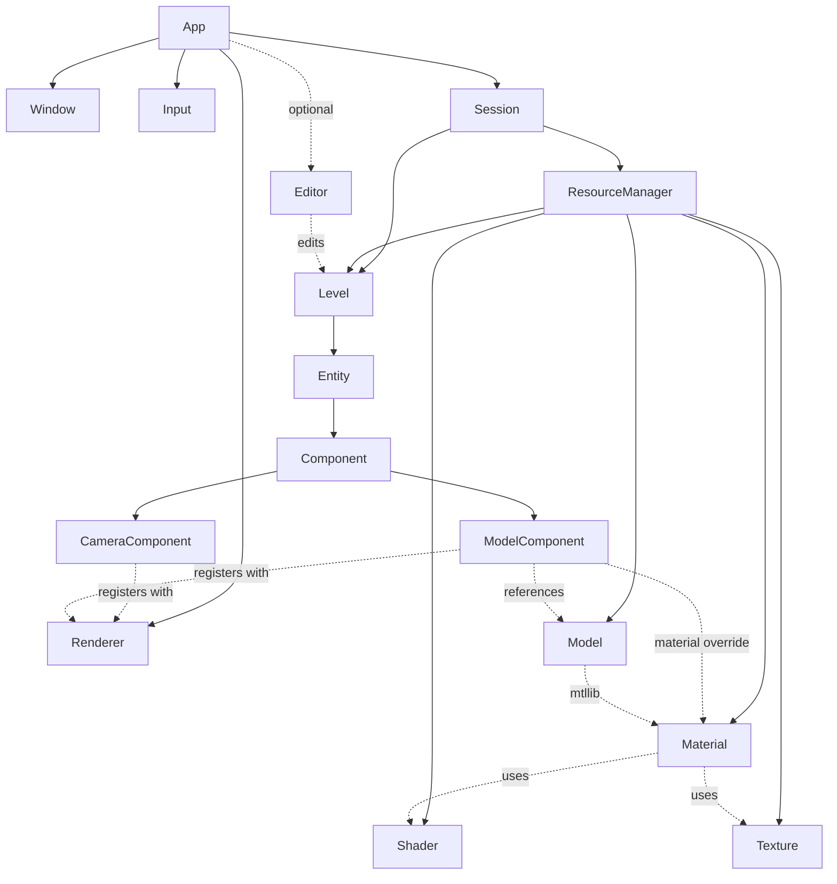

<div align="center">

# gaia3

**A C++20 game engine with an entity-component scene, an OpenGL renderer and a built-in level editor.**


</div>

> [!NOTE]
> gaia3 is in early development. It can author, save and reload levels, and draws models with PBR materials, textures and normal maps lit by directional and point lights, with a shadow map for the sun. See [Current limits](#current-limits).

## Contents

- [Features](#features)
- [Getting started](#getting-started)
- [Using the editor](#using-the-editor)
- [Writing an app](#writing-an-app)
- [How it fits together](#how-it-fits-together)
- [Project layout](#project-layout)
- [Current limits](#current-limits)
- [Dependencies](#dependencies)
- [License](#license)

## Features

**Scene**
- Levels made of entities and components, with one component of each type per entity
- Save and load levels as JSON, including entity clones and resource references
- Components register themselves and can be added by name

**Reflection**
- Custom RTTI with property lists that drive both serialization and the Inspector
- Components get a working Inspector for free, and can override it with their own

**Resources**
- Every resource type has its own folder: `levels/`, `models/`, `materials/`, `shaders/` and `textures/`
- Resources are found by short name, so `models/cube.obj` is simply `cube`
- App assets override the engine's common assets
- Typed references (`ResourceRef<Model>`) that save as names and pick from a dropdown in the Inspector

**Rendering**
- OpenGL 3.3 core renderer that draws into a framebuffer
- Wavefront `.obj` models, where each object or group becomes a mesh with one sub-mesh per material
- Material libraries from `.mtl` files, each material with a colour, textures, a cut-out mask, a normal map, metallic-roughness PBR values or textures, a shader and an optional two-sided flag
- Metallic-roughness PBR lighting (GGX) in linear colour, tone mapped for the screen
- Shaders in `.glsl` files, with both stages in one file
- BMP, PNG, JPEG and TGA textures, with optional import settings for filtering, wrapping and mipmaps
- Texture formats and sampling described by `TextureProperties`, with presets shared by textures and render targets
- Missing materials and textures draw with a recognisable error texture
- One camera, with mouse look and WASD movement

**Editor**
- Docked layout with Hierarchy, Viewport and Inspector panels, built on ImGui
- Create, clone, rename and delete entities, and add or remove components
- Translate, rotate and scale gizmos in the Viewport, along the world's axes or the entity's own
- Unity and Unreal inspired theme that follows the Windows display scale
- Off by default, each app turns it on through `AppConfig`

**Foundations**
- Math library: vectors, matrices, quaternions and transforms
- Logging with a clear policy (see [Logging](#logging))
- A GoogleTest suite with over 400 tests

## Getting started

### Requirements

| Tool | Notes |
|---|---|
| [MSYS2](https://www.msys2.org/) UCRT64 | GCC toolchain, with `C:\msys64\ucrt64\bin` on your `PATH` |
| [CMake](https://cmake.org/) 3.24+ | Apps link the engine as a whole archive, so every resource type and component registers itself |
| [vcpkg](https://vcpkg.io/) | Expected at `C:/vcpkg`. Dependencies install automatically on the first configure |

### Visual Studio

Open the folder in Visual Studio. `CMakeSettings.json` provides the `x64-Debug` and `x64-Release` configurations, so pick one and build.

### Command line

```bash
cmake -S . -B out/build/x64-Debug -G "MinGW Makefiles" -DCMAKE_BUILD_TYPE=Debug -DCMAKE_TOOLCHAIN_FILE=C:/vcpkg/scripts/buildsystems/vcpkg.cmake -DVCPKG_TARGET_TRIPLET=x64-mingw-dynamic -DVCPKG_HOST_TRIPLET=x64-mingw-dynamic
```

```bash
cmake --build out/build/x64-Debug
```

Tests and samples can be switched off with `-DGAIA3_BUILD_TESTS=OFF` and `-DGAIA3_BUILD_SAMPLES=OFF`.

### Run the sandbox

```bash
./out/build/x64-Debug/samples/sandbox/sandbox.exe
```

| Argument | Effect |
|---|---|
| `-no_editor` | Runs the game alone, full window |
| `-no_dock` | Uses the floating editor layout, currently only used for testing |
| `-frames N` | Closes after `N` frames |
| `-level name` | Opens that level at startup instead of the default one |

### Run the tests

```bash
ctest --test-dir out/build/x64-Debug
```

This also opens the sandbox for a few frames in each editor mode, so it needs a GPU.

## Using the editor

### Camera

Hold the **right mouse button** in the Viewport to control the camera. It keeps control until you release, even if the mouse passes over a panel.

| Input | Action |
|---|---|
| Mouse | Look around |
| `W` `A` `S` `D` | Move |
| `E` / `Q` | Move up / down |
| `Left Shift` | Move five times faster |

### Authoring a level

| Where | What you can do |
|---|---|
| **Level** menu | New, Open, Save, Save As |
| **Gizmo** menu | Switch between Selection, Translate, Rotate and Scale, and between World and Local axes |
| **Settings** menu | Draw mode: Lit, Normals (world-space normals as colours), Shadows (white where the sun reaches), Roughness or Metallic (the PBR values in grey). An Alpha Test toggle that shows cut-outs as whole faces when off. Sun shadow settings: on or off, map size and the two biases. The camera linear and angular speed, shared by every camera. None of it is saved in levels |
| **Hierarchy**, right click on an entity | Rename, Clone, Delete |
| **Hierarchy**, right click on empty space | Create Entity |
| **Inspector**, right click on empty space | Add Component, greyed out for types already present |
| **Inspector**, right click on a component | Remove Component |

Clones are numbered automatically: cloning `Crate` or `Crate (1)` gives the first free name, such as `Crate (2)`. Entity names can repeat, because entities are told apart by their id.

## Writing an app

An app fills in an `AppConfig` and hands control to the engine. This is a shortened version of [`sandbox.cpp`](samples/sandbox/src/sandbox.cpp):

```cpp
#include <gaia3.h>

#include <components/cameraComponent.h>
#include <components/modelComponent.h>

int main()
{
	AppConfig config;
	config.canvas     = { 2560, 1440 };
	config.title      = "Sandbox";
	config.appPath    = SANDBOX_ASSETS_PATH;
	config.commonPath = GAIA3_ASSETS_PATH;

	// The editor stays off unless the app asks for it
	config.editor.enabled   = true;
	config.editor.docked    = true;
	config.editor.gizmoMode = GizmoMode::Translate;

	if( !App::Init( config ) )
		return 1;

	Level* level = App::GetSession().GetCurrentLevel();

	Entity* camera = level->CreateEntity( "Camera" );
	camera->SetPosition( Vec3( 1.0f, 1.0f, -4.12f ) );
	camera->SetRotation( LookAtQuat( Vec3( 0.0f, 0.0f, 1.0f ), Vec3::V_Up ) );
	camera->AddComponent<CameraComponent>();

	// Components are added empty, then each property is set
	Entity* cube = level->CreateEntity( "Cube" );
	cube->AddComponent<ModelComponent>()->SetModel( "cube" );

	App::Run();
	App::Shutdown();
	return 0;
}
```

### Adding a component

Declare the type, then list the properties to reflect. They are saved with the level and appear in the Inspector without further work.

```cpp
class HealthComponent : public Component
{
	RTTI_DECLARE_COMP( HealthComponent, Component )
public:
	void Update() override;

private:
	float m_Health = 100.0f;
};

RTTI_DEFINE_COMP( HealthComponent,
                  RTTI_PROPERTY( m_Health ) )
```

Override `DrawInspector` for a dedicated editing experience, as `CameraComponent` does for its yaw and pitch. Override `OnPropertyChanged` or `OnTransformChanged` to react to edits.

### Materials, shaders and textures

Materials come in libraries: standard `.mtl` files in `materials/`, named after the file. A library holds one material per `newmtl`, and those names only mean something inside it, so `floor` in `sponza.mtl` never clashes with `floor` in another library:

```text
newmtl floor
Kd 1.0 1.0 1.0
map_Kd floor.png
shader default

newmtl arch
map_Kd arch.png
```

| Line | Meaning |
|---|---|
| `Kd` | Colour, multiplied with the texture |
| `map_Kd` | Texture, looked up by file name in `textures/`. A texture that can't be found uses `error` with a warning |
| `map_d` | Cut-out mask, pixels under half opacity aren't drawn. Its alpha when it has one, otherwise its red channel |
| `map_Bump`, `bump`, `norm` | Tangent-space normal map |
| `shader` | Shader in `shaders/`, a gaia3 extension other tools ignore. `default` when left out |
| `Pr`, `Pm` | PBR roughness and metallic, 0 to 1 |
| `map_Pr`, `map_Pm` | Roughness and metallic textures, read from red and multiplied by `Pr` and `Pm` when given |
| `Ns` | Classic shininess, turned into roughness for materials without `Pr` or `map_Pr`. Without any, roughness is 0.5 and metallic 0 |
| `two_sided` | Draws both sides of each face, for single-sheet geometry like leaves. A gaia3 extension other tools ignore |

A model uses the libraries its `mtllib` lines name, found by file name wherever the `.mtl` is. Each sub-mesh then takes the material its `usemtl` line names from those libraries:

| Case | Material used |
|---|---|
| The name is in one of the model's libraries | That material |
| The face has no `usemtl` | The `default` library |
| The name or the library can't be found | The `error` library, with a warning |

A `ModelComponent` can set a material override, a library used instead of the model's own, with `SetMaterialOverride` or the Inspector's MaterialOverride field. Each sub-mesh then looks up its name in that library, and sub-meshes without a name take its first material, so a cube drawn with the `error` library shows the error texture. The libraries the model already uses can't be chosen, they're greyed out in the Inspector, and changing the model clears the override.

Shaders are `.glsl` files holding both stages, each one after a `#type vertex` or `#type fragment` line. The default shader draws the material's colour, texture and normal map, lit by the level's directional and point lights with metallic-roughness PBR. Colour textures are turned from sRGB into linear values, lighting adds up in linear, and the result is tone mapped back to sRGB for the screen.

Shaders can share code with `#include "pbr.glsli"`. Include files are `.glsli` resources in `shaders/`, found by name like any resource, so an app can override them. Each one is pasted once per stage, even when several files include it, and compile errors name the file by number, listed in the message, like `1(4)` for line 4 of the first include. The first directional light with `m_bCastShadows` gets a shadow map, drawn with `shadow.glsl`. It covers a box that starts at the light's entity, `m_ShadowSize` wide across the light, and runs `m_ShadowDepth` along it, whatever the camera does, and the light's Inspector shows it. Cut-out materials cast the shape of their cut-out.

A texture can have import settings in a `.meta` file next to it, such as `error.bmp.meta`:

```json
{ "filter": "nearest", "wrap": "repeat", "mipmaps": true }
```

`filter` is `nearest` or `linear`, `wrap` is `repeat`, `mirror` or `clamp`. Anything left out keeps the `V_DefaultColorRGBA` preset.

Normal maps are read the OpenGL way, green pointing up the texture. A DirectX normal map, green pointing down, like Sponza's `_ddn` textures, needs `{ "flipGreen": true }` in its `.meta`, which inverts green once on load.

### Adding a resource type

Each resource type declares its folder and file extensions. The folder is a required argument, so it can't be forgotten.

```cpp
RTTI_DEFINE_RESOURCE( Level,
                      RTTI_RESOURCE_FOLDER( "levels" ),
                      RTTI_RESOURCE_EXTENSIONS( ".lvl" ),
                      RTTI_PROPERTY( m_Entities ) )
```

Saving always writes into the type's folder. A file found in another folder still loads, and shows its whole path, such as `models/stray` for a level inside `models/`. If two files end up with the same name, the one in the type's folder wins and the other is ignored with a warning.

## How it fits together



### Conventions

| Topic | Convention |
|---|---|
| Forward direction | `-Z` |
| Matrices | Column-major, `a * b` applies `b` first |
| Quaternions | Hamilton product |
| Euler angles | Degrees, applied in the order Z, X, Y |

### Logging

| Macro | Used for |
|---|---|
| `GAIA_INFO` | Progress and environment details |
| `GAIA_WARN` | Something was wrong, but a result was still accepted |
| `GAIA_ERROR` | An operation failed and returned false, the engine continues |
| `GAIA_ASSERT` | Execution stops in every build, with a breakpoint first in Debug |

## Project layout

```text
gaia3/
├── gaia3/                 Engine static library
│   ├── assets/            Common assets: models, materials, shaders, textures and the editor font
│   └── src/
│       ├── components/    CameraComponent, ModelComponent, lights (DirectionalLightComponent, PointLightComponent)
│       ├── core/          App, Session, logging, type aliases
│       ├── gfx/           Renderer, Framebuffer, Model, Material, Shader, Texture, OBJ importer
│       ├── math/          Vectors, matrices, quaternions, transforms
│       ├── platform/      Window and Input
│       ├── scene/         Level, Entity, Component, Editor, Inspector
│       └── system/        RTTI, Resource, ResourceManager, ResourceRef
├── gaia3_tests/           GoogleTest suite
├── samples/sandbox/       Sample app, and the reference for using the engine
├── vcpkg.json             Dependency manifest
└── CMakeSettings.json     Visual Studio configurations
```

## Current limits

- **Lighting:** up to 8 directional and point lights, with a flat ambient term. Only one directional light gets shadows, from a single shadow map over a fixed box, so they get blurrier as the box grows. Without reflections of the surroundings (image-based lighting), metals only shine where a light hits them. Cascaded shadows, point light shadows and image-based lighting are planned.
- **Materials:** only the lines listed in [Materials, shaders and textures](#materials-shaders-and-textures) are read from `.mtl` files.
- **Model formats:** only OBJ for now. glTF and FBX importers are planned, along with skeletal animation.
- **Cameras:** the renderer uses one camera, and extra ones are ignored. Choosing a render target per camera is planned.
- **Undo:** there's no undo or redo yet, and no warning about unsaved changes. Both are planned.
- **Selection:** entities are selected from the Hierarchy, as clicking in the Viewport doesn't pick them.
- **Hierarchy:** entities have no parents.
- **OBJ files:** only positive face indices are supported.
- **Platform:** built and tested on Windows with MinGW UCRT64.

## Dependencies

Installed through vcpkg from [`vcpkg.json`](vcpkg.json):

| Library | Used for |
|---|---|
| [GLFW](https://www.glfw.org/) | Window and input |
| [glad](https://glad.dav1d.de/) | OpenGL loading |
| [Dear ImGui](https://github.com/ocornut/imgui) | Editor interface, docking branch |
| [ImGuizmo](https://github.com/CedricGuillemet/ImGuizmo) | Viewport gizmos |
| [JsonCpp](https://github.com/open-source-parsers/jsoncpp) | Level serialization |
| [spdlog](https://github.com/gabime/spdlog) | Logging |
| [stb_image](https://github.com/nothings/stb) | Reading BMP, PNG, JPEG and TGA textures |
| [GoogleTest](https://github.com/google/googletest) | Tests |

The editor font is [Cascadia Mono](https://github.com/microsoft/cascadia-code), included under the SIL Open Font License. See [`LICENCE_OFL.txt`](gaia3/assets/fonts/LICENCE_OFL.txt).

## License

gaia3 is released under the [MIT License](LICENSE). The font and the libraries above keep their own licenses.
